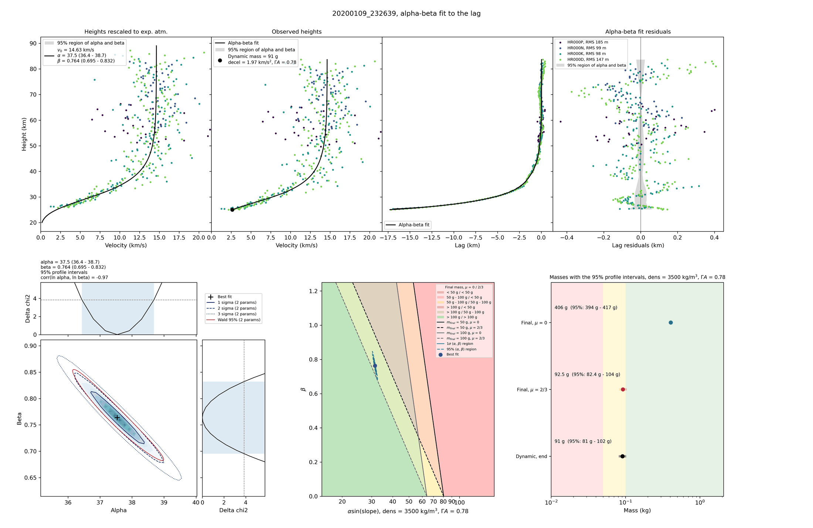

# Alpha-beta fit of a fireball

**`wmpl.Utils.AlphaBeta`** fits the alpha-beta model of Gritsevich (2012) to a solved trajectory. Alpha is the
ballistic coefficient (the mass of the air column in front of the meteoroid over its own mass at entry) and beta
is the mass loss parameter. Together with the entry angle they place a fireball on the meteorite survival
diagram, and they give the initial and final masses, the dynamic mass at the end and the peak dynamic pressure.

## Table of Contents

- [Quick start](#quick-start)
- [The fit to the lag](#the-fit-to-the-lag)
- [Uncertainties of alpha and beta](#uncertainties-of-alpha-and-beta)
- [The summary plot and the final masses](#the-summary-plot-and-the-final-masses)
- [Example: the 2020-01-09 fireball over Croatia](#example-the-2020-01-09-fireball-over-croatia)
- [When beta only has an upper limit](#when-beta-only-has-an-upper-limit)
- [Limits](#limits)

---

## Quick start

Fit alpha and beta to a trajectory and show the plots:

```
python -m wmpl.Utils.AlphaBeta /path/to/20200109_232639_trajectory.pickle
```

Also estimate the uncertainties, and save the plots next to the pickle instead of showing them:

```
python -m wmpl.Utils.AlphaBeta /path/to/20200109_232639_trajectory.pickle --errors --saveplots --hideplots
```

Two plots are saved: `<timestamp>_alpha_beta_summary.png` with all results in one figure (see [The summary plot
and the final masses](#the-summary-plot-and-the-final-masses)), and `_alpha_beta_dyn_pressure.png` with the
dynamic pressure along the path (with its 95% band with `--errors`). `--dens` and `--ga` set the bulk density
and the product of the drag and the shape coefficients used for the masses (3500 kg/m^3 and 0.78 by default).

---

## The fit to the lag

By default (`--lagfit full`), alpha and beta are fitted to the entry lag against the slant air column traversed
along the path, with an offset and a noise level for every station (`fitAlphaBetaEntryLag()`). The fit uses the
lag of all used points of all stations, so neither noisy point-to-point velocities nor a smoothing model of the
lag are needed.

- The height coordinate of the model is the slant column, the air column traversed along the path, from the
  NRLMSIS atmosphere at the time of the fireball. In this coordinate the model holds in any atmosphere and on a
  path whose slope changes, e.g. with the curvature of the Earth.
- The lag of every point is fitted with the entry lag of the model at its column height (the distance by which
  the meteor trails a companion which keeps moving at the entry velocity), a straight line in time, which gives
  the entry velocity V_e, and an offset for every station. The offsets absorb constant clock offsets between the
  stations, so these do not affect V_e.
- A point is weighted by 1/(sigma_S/v_i)^2, with sigma_S the noise level of its station, estimated from the
  scatter of its distances about a quartic in time, and v_i the velocity of the model at the point divided by
  V_e. The noise and the offset of every station are printed, with the reduced chi-squared of the fit and the
  integrated autocorrelation time of its residuals.

`--lagfit simple` fits alpha, beta and V_e to the distances along the path at the observed times, with one offset
and one noise level for all stations (`fitAlphaBetaLag()`). The alpha-beta velocity is integrated along the path
to give the model distance at every observed time. The heights are mapped to the exponential atmosphere of the
model by the air column above them (`--atmrescale column`, the default) or by the local density
(`--atmrescale density`, which biases alpha and beta where the scale height is not 7.16 km). `--atmrescale` and
`--slopeunc` apply only to the simple fit.

If the full fit cannot be set up, because the path does not descend at its first point or the noise of the
distances cannot be estimated, the simple fit is used and a note is printed.

In both fits:

- The distance gained from gravity along the path is taken out, as the model has no gravity.
- V_e is the asymptote of the model above the atmosphere, so it can differ a little from the initial velocity of
  the trajectory solution. Both are printed, and the masses use V_e.
- The fit starts from a grid of alpha and beta and from the fit to the observed velocities, as the cost has local
  minima.

The top row of the summary plot shows the velocities against the observed heights, with the model from above the
first point down to below the last one, the lag, the lag residuals and the dynamic pressure. The points are
colored by station with the colors of the trajectory plots, and the legend gives the RMS of the lag residuals of
every station, so a station which does not agree with the others stands out. With the full fit, the residuals are
those left after the offset of every station, so a constant offset of a station does not show in them. They are
given as distances along the path at the observed times (the lag residual times the normalized velocity of the
model), as a residual in the lag grows as 1/v where the meteor is slow.

---

## Uncertainties of alpha and beta

Every run prints the 95% profile intervals of alpha and beta. One parameter is fixed on a grid, and the other
one and V_e (and the offsets of the stations with the full fit) are fitted again at every point. The interval is
where the rise of the cost, scaled by the variance of the lag residuals at the best fit (the reduced chi-squared
with the full fit), stays below the chi-squared threshold of one parameter (3.84 for 95%). If the interval
reaches the bound of the fit on one side, that side is not constrained by the data, and this is printed. For the
Croatia example below, `--lagfit simple` prints:

```
95% profile intervals (lag residuals assumed independent):
  Alpha: 36.4 - 38.7
  Beta:  0.695 - 0.832
```

With the full fit of the lag (`--lagfit full`, the default), the rise of the cost is also divided by the
integrated autocorrelation time of the residuals, which is about 1 for independent errors. The residuals of real
fireballs are usually correlated in time, so the intervals are wider than with `--lagfit simple`, and beta more
often gets only an upper limit. This is intended. In synthetic tests with noise correlated in time
(autocorrelation times of 5-40), the 95% intervals of the full fit contained the true values in 84-95% of the
cases, against 38-75% when the rise is divided by the variance of the residuals alone. The full fit prints its
intervals under the header

```
95% profile intervals (threshold scaled by the autocorrelation time of the residuals):
```

The intervals contain the random noise of the distances, also when it is correlated in time, but not the
systematic errors of the stations, e.g. of their calibration. The fit takes such an error into alpha and beta,
and the residuals do not show it. To check for it, the full fit is repeated without every station in turn when
there are at least three stations. The stations without which alpha or beta falls outside the intervals are
marked with `*`. A fit without one station which is far outside the intervals points to a systematic error of
that station.

`--errors` also gives the Wald uncertainties from the covariance of the fit, which are propagated into the
masses, and draws the uncertainties in the bottom left of the summary plot:

- The main panel shows the likelihood on a grid of alpha and beta (with V_e fitted at every point) and its 1, 2
  and 3 sigma regions of two parameters. The Wald region of the same level is drawn in red for comparison.
- The side panels show the profiles of alpha (top) and beta (right), with the threshold as a dashed line and the
  95% interval shaded.

The 1 sigma and the 95% regions are also drawn on the survival diagram, so the uncertainty of a fireball can be
compared to the final mass lines directly. In the top row, the gray bands show the range of the models with
alpha and beta within the 95% region: their velocities, their lag (with `--lagfit simple`), and their difference
from the best fit in the panel of the residuals. A band which is narrow compared to the residuals means that the
residuals come from the data and not from the uncertainty of the model.

Alpha and beta are strongly anticorrelated, as a larger mass loss can be traded for a smaller ballistic
coefficient, so the region is a narrow tilted valley. When both parameters are well constrained, the profile and
the Wald regions agree.

With `--errors`, the final masses, the dynamic mass and the peak dynamic pressure also get 95% profile
intervals: the range of their values over the models within the 95% interval of one parameter (the
points of the grid and of the profiles below the threshold of 3.84). These hold also when beta only has an upper
limit, where the Wald errors of the masses are not defined. They include only the uncertainty of the fit, while
the Wald errors also include `--densunc` and, with `--lagfit simple`, `--slopeunc`. The full fit does not use
`--slopeunc` and prints a note, as alpha*sin(slope) is fixed by the data and the slope does not change its
masses. If the models within the interval stop decelerating at the end, the dynamic mass has no upper limit.

If the profile finds a better fit than the fit itself, which then ended in a local minimum, the fit is repeated
from that point and a note is printed.

---

## The summary plot and the final masses

`_alpha_beta_summary.png` shows all results of a run in one figure: the fit with the bands of the 95% region and
the dynamic pressure along the path on top, and below it the uncertainties of alpha and beta, the survival
diagram with the final mass on straight lines, and the final and the dynamic masses with their 95% intervals.

The final mass of the alpha-beta model, for a final velocity much smaller than the initial one, is

```
m_final = m0s/(alpha*sin(slope))^3*exp(-beta/(1 - mu)),    m0s = (Gamma*A*rho_0*h_0/dens^(2/3))^3
```

so the final mass is M on the line

```
beta = (1 - mu)*(ln(m0s/M) - 3*ln(alpha*sin(slope)))
```

which is straight when beta is on a linear axis and alpha*sin(slope) on a logarithmic one. The classic survival
diagram (`plotAlphaBetaSurvivalDiagram()`) has the same lines, but plotted against ln(beta) they curve. Beta is
on a linear axis also because the final mass depends on it exponentially: below about 0.1 it barely changes the
final mass, while every unit of beta divides it by e (for mu = 0). A logarithmic axis would spend most of its
height on the small values of beta, where nothing changes. An upper limit of beta is a region which reaches beta
= 0, no mass loss.

The zones are colored by the final mass: red below 50 g, yellow between 50 and 100 g, and green above 100 g. As
mu is not known, the class is found for both mu = 0 (no rotation, solid lines) and mu = 2/3 (fast rotation,
dashed lines). Where the two classes agree the zone has their color, and where they differ it has the mix of the
two colors, e.g. brown for above 100 g with mu = 0 but below 50 g with mu = 2/3. The legend gives the classes of
both mu. The masses in the last panel use the full alpha-beta solution with the final velocity of the model, so
they can differ by a few percent from the approximation of the lines. For a meteor which barely decelerates
(beta at its upper bound), the approximation of a final velocity much smaller than the initial one does not
hold, and the zone of the best fit can disagree with the masses in the last panel, which are then the ones to
use.

If the fireball lost less than 10% of its velocity by the end of the fit (`MIN_VELOCITY_LOSS`), the dynamics do
not constrain alpha, beta and the masses: in the GMN and UWO fireballs, only 1 of 61 such fits had alpha and beta
constrained, against 190 of 244 fits which lost more than half of the velocity. A note is printed, the masses in
the summary plot are given as ~0, as a fireball which ends without decelerating usually ablates completely, and
the survival diagram is marked as not constrained.

The initial mass is not shown in the plots, as the dynamics alone do not constrain it well (it is usually
underestimated 4-10 times).

---

## Example: the 2020-01-09 fireball over Croatia

The fireball was observed by four Global Meteor Network cameras in Croatia from 84 to 25 km, and slowed from
14.6 to 2.6 km/s. The numbers and the figure of this example were made with `--lagfit simple --errors`. The fit
to the 384 points of the lag gives (masses for 3500 kg/m^3 and Gamma*A = 0.78):

| Quantity | Value |
|---|---|
| V_e | 14.633 +/- 0.010 km/s |
| Alpha | 37.5 (95%: 36.4 - 38.7) |
| Beta | 0.764 (95%: 0.695 - 0.832) |
| ln(alpha*sin(slope)) | 3.44 |
| ln(beta) | -0.27 |
| Lag residuals RMS | 129 m |
| Final mass, mu = 0 | 406 g (95%: 394 - 417 g) |
| Final mass, mu = 2/3 | 93 g (95%: 82 - 104 g) |
| Dynamic mass at 25 km | 91 g (95%: 81 - 102 g) |
| Peak dynamic pressure | 1.07 MPa at 31.8 km (95%: 1.06 - 1.08 MPa) |

The lag residuals of the four stations are 98-185 m RMS, and the band of the models within the 95% region is at
most a few tens of meters wide. The profiles of both parameters are parabolas, and the 95% profile region
matches the Wald region. With the default density of 3500 kg/m^3 and Gamma*A = 0.78, the whole 95% region is
above 100 g for mu = 0 and around 100 g for mu = 2/3, so a meteorite of about 100 g or more most likely fell:



---

## When beta only has an upper limit

The mass loss shows in the lag only where the meteoroid decelerates strongly. If that part is short or noisy,
the lag constrains beta only from above: any beta from zero up to some value fits it equally well, and the best
fit can end anywhere in that range, also at practically zero. The profile of beta is then flat towards small
values, and the output says so (here with `--lagfit simple`):

```
95% profile intervals (lag residuals assumed independent):
  Alpha: 49.7 - 60.4
  Beta:  < 0.503 (no lower limit)
NOTE: The lag only gives an upper limit of beta, so ln(beta) is not meaningful
```

Report beta as an upper limit in that case. The 95% region on the survival diagram is then an open valley
towards small ln(beta), and a region reaching beta = 0 in the summary plot, and the Wald uncertainty of beta is
meaningless (it can be thousands of percent). Alpha, the deceleration, the dynamic mass and the peak dynamic
pressure are usually still well constrained.

---

## Limits

- The slope of the alpha-beta model is the apparent elevation of the radiant. If it is negative, the direction of
  the trajectory solution is likely reversed (check its timing), and the local slope of the observed path along
  the direction of the motion is used instead. A meteor which climbs along the observed path, e.g. an
  Earth-grazer, cannot be fitted by the model, and AlphaBeta stops with an error. If the path does not descend
  at its first point, the full fit cannot be set up and the simple fit is used, with a note. The simple fit does
  not let the height rise along the path: a part of the path which climbs is fitted as level, at the lowest
  height of the points before it.

- The intervals of the full fit contain the random noise, also when it is correlated in time, but not the
  systematic errors of the stations. Check the fits without every station and the residuals of every station
  in the summary plot. The intervals of `--lagfit simple` assume that the lag residuals are independent: a
  station with a timing or a geometric offset makes the residuals of all its points correlated, and the real
  intervals are then wider.
- The model is a single body with a constant shape and mu. Fragmentation shows as a trend in the lag residuals
  which the model cannot follow.
- The masses depend on the assumed density and on the drag and shape coefficients, which are not part of the
  uncertainties unless `--densunc` is given. The initial masses are usually 4-10 times underestimated.
