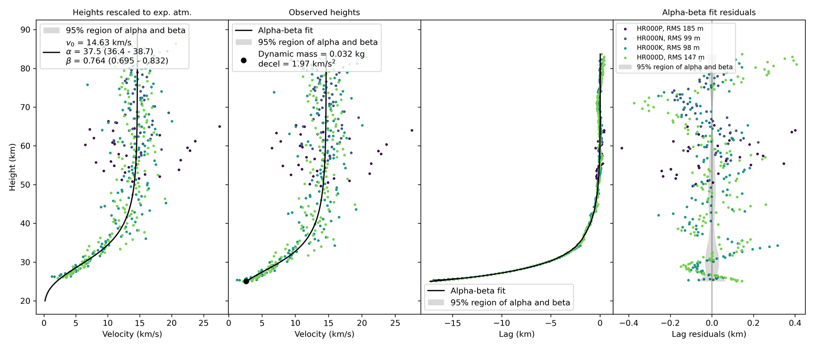
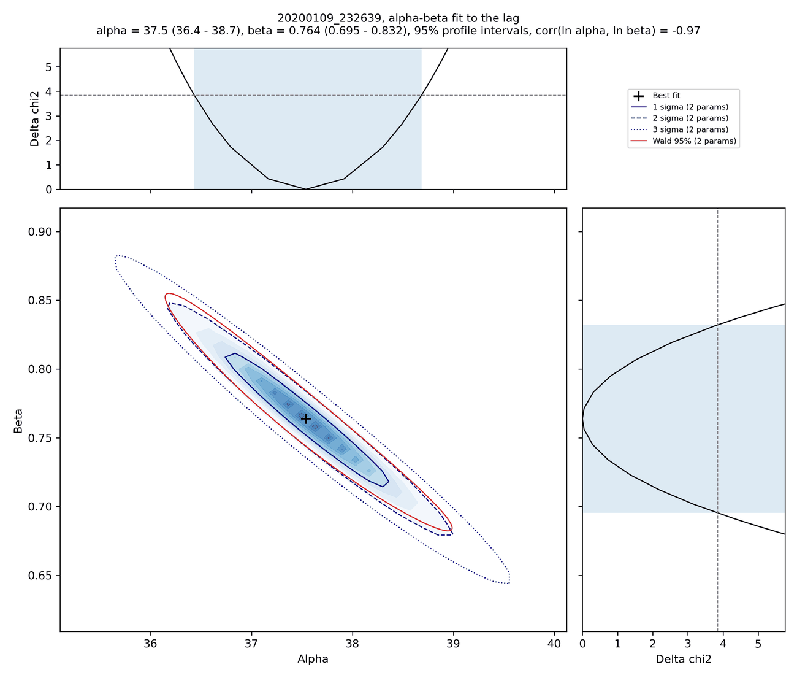
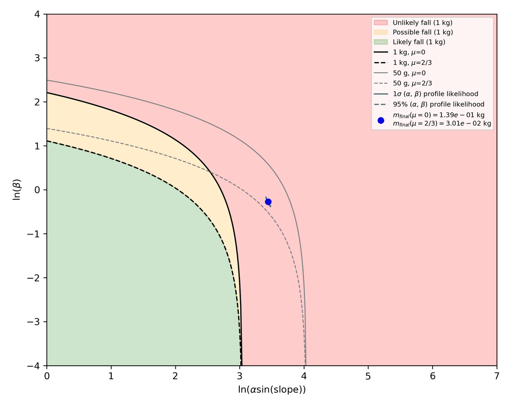

# Alpha-beta fit of a fireball

**`wmpl.Utils.AlphaBeta`** fits the alpha-beta model of Gritsevich (2012) to a solved trajectory. Alpha is the
ballistic coefficient (the mass of the air column in front of the meteoroid over its own mass at entry) and beta
is the mass loss parameter. Together with the entry angle they place a fireball on the meteorite survival
diagram, and they give the initial and final masses, the dynamic mass at the end and the peak dynamic pressure.

## Table of Contents

- [Quick start](#quick-start)
- [The fit to the lag](#the-fit-to-the-lag)
- [Uncertainties of alpha and beta](#uncertainties-of-alpha-and-beta)
- [Example: the 2020-01-09 fireball over Croatia](#example-the-2020-01-09-fireball-over-croatia)
- [When beta only has an upper limit](#when-beta-only-has-an-upper-limit)
- [Limits](#limits)

---

## Quick start

Fit alpha and beta to a trajectory and show the plots:

```
python -m wmpl.Utils.AlphaBeta /path/to/20200109_232639_trajectory.pickle
```

Also estimate the uncertainties, and save the plots next to the pickle instead of showing them:

```
python -m wmpl.Utils.AlphaBeta /path/to/20200109_232639_trajectory.pickle --errors --saveplots --hideplots
```

The plots are saved as `<timestamp>_alpha_beta_fit.png`, `_alpha_beta_survival.png`,
`_alpha_beta_dyn_pressure.png`, `_alpha_beta_mag_vs_dyn_pressure.png` and, with `--errors`,
`_alpha_beta_errors.png`. `--dens` and `--ga` set the bulk density and the product of the drag and the shape
coefficients used for the masses (3500 kg/m^3 and 0.55 by default).

---

## The fit to the lag

Alpha, beta and the entry velocity V_e are fitted directly to the distances along the track at the observed
times, i.e. to the lag, of all used points of all stations. The alpha-beta velocity is integrated along the path
to give the model distance at every observed time, so neither noisy point-to-point velocities nor a smoothing
model of the lag are needed.

- The heights are mapped to the exponential atmosphere of the model by the air column above them
  (`--atmrescale column`), from the NRLMSIS atmosphere at the time of the fireball.
- The distance gained from gravity along the path is taken out, as the model has no gravity.
- V_e is the asymptote of the model above the atmosphere, so it can differ a little from the initial velocity of
  the trajectory solution. Both are printed, and the masses use V_e.
- The fit starts from a grid of alpha and beta and from the fit to the observed velocities, and keeps the best
  result, as the cost has local minima.

The fit plot shows the velocities against the heights rescaled to the exponential atmosphere and against the
observed heights, the lag, and the lag residuals. The points are colored by station with the colors of the
trajectory plots, and the legend gives the RMS of the lag residuals of every station, so a station which does
not agree with the others stands out.



---

## Uncertainties of alpha and beta

Every run prints the 95% profile intervals of alpha and beta. One parameter is fixed on a grid, and the other
one and V_e are fitted again at every point. The interval is where the rise of the cost, scaled by the variance
of the lag residuals at the best fit, stays below the chi-squared threshold of one parameter (3.84 for 95%). If
the interval reaches the bound of the fit on one side, that side is not constrained by the data, and this is
printed:

```
95% profile intervals (lag residuals assumed independent):
  Alpha: 36.4 - 38.7
  Beta:  0.695 - 0.832
```

`--errors` also gives the Wald uncertainties from the covariance of the fit, which are propagated into the
masses, and makes the plot of the uncertainties (`_alpha_beta_errors.png`):

- The main panel shows the likelihood on a grid of alpha and beta (with V_e fitted at every point) and its 1, 2
  and 3 sigma regions of two parameters. The Wald region of the same level is drawn in red for comparison.
- The side panels show the profiles of alpha (top) and beta (right), with the threshold as a dashed line and the
  95% interval shaded.

The 1 sigma and the 95% regions are also drawn on the survival diagram, so the uncertainty of a fireball can be
compared to the final mass lines directly. In the fit plot, the gray bands show the range of the models with
alpha and beta within the 95% region: their velocities, their lag, and their difference from the best fit in
the panel of the residuals. A band which is narrow compared to the residuals means that the residuals come from
the data and not from the uncertainty of the model.

Alpha and beta are strongly anticorrelated, as a larger mass loss can be traded for a smaller ballistic
coefficient, so the region is a narrow tilted valley. When both parameters are well constrained, the profile and
the Wald regions agree.

---

## Example: the 2020-01-09 fireball over Croatia

The fireball was observed by four Global Meteor Network cameras in Croatia from 84 to 25 km, and slowed from
14.6 to 2.6 km/s. The fit to the 384 points of the lag gives:

| Quantity | Value |
|---|---|
| V_e | 14.633 +/- 0.010 km/s |
| Alpha | 37.5 (95%: 36.4 - 38.7) |
| Beta | 0.764 (95%: 0.695 - 0.832) |
| ln(alpha*sin(slope)) | 3.44 |
| ln(beta) | -0.27 |
| Lag residuals RMS | 129 m |
| Final mass, mu = 0 and 2/3 | 142 g and 32 g |
| Dynamic mass at 25 km | 32 g |
| Peak dynamic pressure | 1.07 MPa at 31.8 km |

The lag residuals of the four stations are 98-185 m RMS (the fit plot above), and the band of the models within
the 95% region is at most a few tens of meters wide. The profiles of both parameters are parabolas, and the 95%
profile region matches the Wald region:



On the survival diagram the 95% region lies between the 50 g lines of mu = 0 and mu = 2/3, and it is small
compared to the distance to the 1 kg lines:



---

## When beta only has an upper limit

The mass loss shows in the lag only where the meteoroid decelerates strongly. If that part is short or noisy,
the lag constrains beta only from above: any beta from zero up to some value fits it equally well, and the best
fit can end anywhere in that range, also at practically zero. The profile of beta is then flat towards small
values, and the output says so:

```
95% profile intervals (lag residuals assumed independent):
  Alpha: 49.7 - 60.4
  Beta:  < 0.503 (no lower limit)
NOTE: The lag only gives an upper limit of beta, so ln(beta) is not meaningful
```

Report beta as an upper limit in that case. The 95% region on the survival diagram is then an open valley
towards small ln(beta), and the Wald uncertainty of beta is meaningless (it can be thousands of percent). Alpha,
the deceleration, the dynamic mass and the peak dynamic pressure are usually still well constrained.

---

## Limits

- The intervals assume that the lag residuals are independent. A station with a timing or a geometric offset
  makes the residuals of all its points correlated, and the real intervals are then wider. Check the residuals of
  every station in the fit plot.
- The model is a single body with a constant shape and mu. Fragmentation shows as a trend in the lag residuals
  which the model cannot follow.
- The masses depend on the assumed density and on the drag and shape coefficients, which are not part of the
  uncertainties unless `--densunc` is given. The initial masses are usually 4-10 times underestimated.
