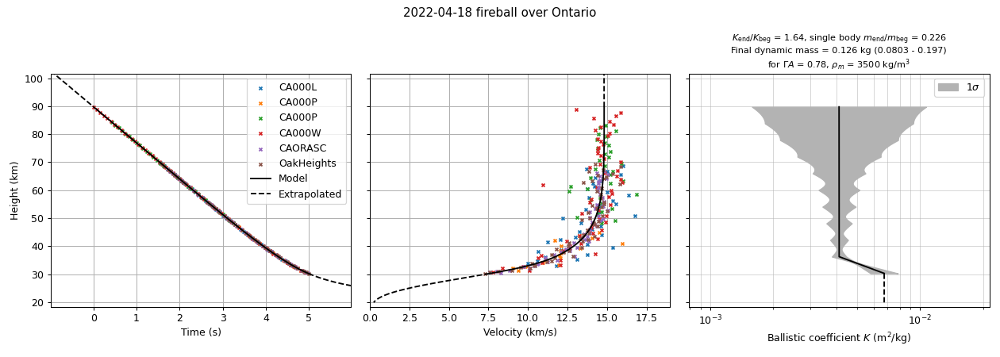

# Drag fit of the motion along a trajectory, and sampling it

**`wmpl.Utils.DragFit`** fits a physical drag model to the lengths and times of a solved
trajectory. It gives smooth positions, times and velocities along the whole trajectory, extrapolates
them above the beginning and below the end, and shows how the ballistic coefficient of the meteor
changed during the flight. **`wmpl.Utils.SampleTrajectoryPositions`** uses it to sample the trajectory
by height or by time, which is the usual first step of a dark flight model.

The ballistic coefficient is fitted from the dynamics alone, unlike in
[`wmpl.MetSim.DynamicMassFit`](../MetSim/DynamicMassFit.py), which computes a mass from the drag equation
for an assumed shape and density.

## Table of Contents

- [Quick start](#quick-start)
- [The model](#the-model)
- [Command line reference](#command-line-reference)
- [Reading the output](#reading-the-output)
- [Using it as a library](#using-it-as-a-library)
- [Interpreting the ballistic coefficient](#interpreting-the-ballistic-coefficient)
- [The dynamic mass](#the-dynamic-mass)
- [Limits of the model](#limits-of-the-model)
- [Troubleshooting](#troubleshooting)

---

## Quick start

Fit the model to a trajectory, print the table of the ballistic coefficient and show the plots:

```
python -m wmpl.Utils.DragFit /path/to/20191023_091225_trajectory.pickle
```

Sample the trajectory every 0.5 km between the observed beginning and end heights (`-1` means the
observed height), or between 30 and 15 km, below the end, for a dark flight model:

```
python -m wmpl.Utils.SampleTrajectoryPositions traj.pickle -1 -1 0.5
python -m wmpl.Utils.SampleTrajectoryPositions traj.pickle 30 15 0.1
```

Sample by time instead, every 0.05 s from 0 to 2 s after the reference time of the trajectory:

```
python -m wmpl.Utils.SampleTrajectoryPositions traj.pickle 0 2 0.05 --time
```

An example trajectory is included in the repository:
`wmpl/Dynesty/examples/20191023_091225/20191023_091225_trajectory.pickle`.

---

## The model

The meteor moves along the solved trajectory and is decelerated by atmospheric drag:

```
dv/dt = -K*rho*v^2 + g_along
```

where `rho` is the NRLMSISE-00 air density along the path, `g_along` the component of gravity along
the path, and `K` the ballistic coefficient,

```
K = Gamma*A / (m^(1/3) * rho_m^(2/3))
```

with the drag coefficient `Gamma`, the shape factor `A`, the mass `m` and the bulk density `rho_m`.
`K` has units of m²/kg. It is the drag area per unit mass, `K = C_D*S/(2m)`.

- **The fit.** `ln K` is a sum of ramps, one per segment of the observed part, and is only allowed to
  grow, as ablation and fragmentation both increase it. The equation is solved exactly in the specific
  kinetic energy, and the model is fitted to the lengths along the track at the observed times of all
  used points (ignored points and stations are skipped), with a robust loss and a small penalty on
  the growth of `K`.
- **Above the beginning** the meteor moves without drag, only accelerated by gravity, as it barely
  decelerates in the thin air. With `--dragabove` the ballistic coefficient at the first point is
  kept there instead. As `K` can only have been smaller above, this is the largest possible
  deceleration, and the model then stops where the velocity would have grown by 10%.
- **Below the end** `K` is kept at its last value, which is drag-only flight with gravity, as at the
  beginning of the dark flight. Ablation essentially stops below about 3 km/s, so below that speed
  this is exact.
- **Gravity** bends the path by the angle `theta`, `dtheta/dt = g_perp/v`. Drag damps the velocity
  gained from gravity like the rest of the velocity, so the bending grows quickly as the meteor slows
  down. The model is computed until the path has bent by 5 deg from the first point. Further on, a
  dark flight model has to be used.
- **Gravity drop.** If the trajectory was solved with the gravity correction, the positions in the
  observed part are dropped from the line in the same way as in the trajectory solver. Below the end
  the path continues along the direction bent by `theta`, and the radiant of the samples is bent by
  `theta`.
- **Heights** are above the mean sea level, as everywhere in WMPL.

On 338 trajectories of real fireballs, the fit residuals are 173 m (median), and hiding the first or
last 20% of the points and predicting them from the rest gives errors of 233 m and 463 m.

---

## Command line reference

`python -m wmpl.Utils.DragFit traj.pickle [options]`

| Flag | Description |
| :--- | :--- |
| `-k`, `--knots` | Number of segments of the ballistic coefficient. One for every 25 points by default, between 3 and 15. |
| `-a`, `--dragabove` | Keep the ballistic coefficient of the first point above the beginning, instead of moving without drag. |
| `-g`, `--ga` | The product of the drag coefficient Gamma and the shape factor A, assumed for the dynamic mass. 0.78 by default. |
| `-d`, `--dens` | The bulk density assumed for the dynamic mass (kg/m³). 3500 by default. |

`python -m wmpl.Utils.SampleTrajectoryPositions traj.pickle beg end step [options]`

| Argument | Description |
| :--- | :--- |
| `beg`, `end`, `step` | Heights of the first and last sample and the step (km). `-1` uses the observed beginning or end height. With `--time` they are times relative to the reference time of the trajectory (s), and `-1` has no special meaning. |
| `-t`, `--time` | Sample by time instead of height. |
| `-a`, `--dragabove` | As above. |

---

## Reading the output

**The table** printed by `DragFit` (an example from a fireball over Ontario, 2022):

```
Drag model of the motion: dv/dt = -K*rho*v² + g
    Points: 267, segments of K: 10, residuals RMS = 62.4 m, robust scale = 50.3 m
    First point: t = 0.002 s, v = 14.821 km/s, h = 89.749 km
    Gravity drop: yes, above the first point: no drag
    K end/beg = 1.64, single-body m end/beg = 0.226
    Final dynamic mass = 0.126 kg (1 sigma 0.0803 - 0.197 kg), for Gamma*A = 0.78 and bulk density = 3500 kg/m³

 Seg, Ht beg, Ht end, Time beg,  Vel beg,  Dyn pres,     K beg,     K end, K std, Growth, Signif
    ,   (km),   (km),      (s),   (km/s), beg (kPa),   (m²/kg),   (m²/kg),   (%),    (x), (sigma)
   1,  89.75,  83.80,    0.002,   14.821,       0.8,  4.11e-03,  4.12e-03,    81,   1.00,    0.0
 ...
   9,  42.18,  36.23,    3.749,   13.345,     511.9,  4.12e-03,  4.12e-03,     8,   1.00,    0.0
  10,  36.23,  30.28,    4.289,   11.734,     958.7,  4.12e-03,  6.75e-03,    15,   1.64,    2.2 *
```

- **Residuals RMS** is the scatter of the observed lengths around the model, along the track.
- **Dyn pres** is the dynamic pressure `rho*v^2` at the top of the segment.
- **K std** is the relative uncertainty of `K` at the bottom of the segment (1 sigma). It is large
  high up, where the meteor barely decelerates, and `inf` where the data do not constrain `K`.
- **Growth** is the factor by which `K` grows in the segment, and **Signif** its significance in
  sigma. A star marks the segments where `K` grows by more than 2 sigma.
- **K end/beg** and **single-body m end/beg** are the total growth of `K` and the mass ratio a single
  body of a constant shape would need to explain it (`m ~ K^-3`).
- **Final dynamic mass** is the dynamic mass of the leading body at the last point, for the assumed
  `Gamma*A` and density (see [the dynamic mass](#the-dynamic-mass)).

**The plots** show the height against time, the velocity against height and the ballistic
coefficient against height with its 1 sigma band. The data are the solver's points, and the
velocities of the data are point-to-point differences, which are noisy. The model is solid in the
observed part and dashed where it is extrapolated.



The plots for the fireball of the table above:

- **Height against time.** The model goes through the points of all six cameras. Above the beginning
  it continues without drag, and below the end at 30 km it continues as a drag flight, which goes
  beyond the plotted time range down to 20 km, where the path has bent by 5 deg.
- **Velocity against height.** The meteor barely decelerates above 50 km, and slows from 14.3 km/s at
  50 km to 7.6 km/s at the end. The drag flight below the end slows it down to 0.25 km/s at 20 km.
- **Ballistic coefficient against height.** `K` is constant down to 36 km and grows by a factor of
  1.64 in the last segment (2.2 sigma). The MetSim model of this fireball has a fragmentation of 70% of
  the mass of the main fragment at 33.8 km, which grows `K` by 1.56. The band widens above 60 km,
  where the deceleration is too small to constrain `K`. The title of the panel gives the final dynamic mass of the
  leading body, 0.13 kg (0.08 to 0.20 kg) for `Gamma*A = 0.78` and `rho_m = 3500 kg/m³`.

**The samples** printed by `SampleTrajectoryPositions` give, for every sample, the time, the
geographical coordinates, the ground-fixed azimuth and elevation of the radiant, and the velocity in
the ECI frame (`Vel`) and relative to the ground (`Vgnd`). Samples outside the observed part are
marked with a star. Samples outside the modelled part are skipped, and a message gives the modelled
range of heights and times.

---

## Using it as a library

```python
import os

import numpy as np

from wmpl.Utils.DragFit import DragFit, plotDragFit
from wmpl.Utils.Pickling import loadPickle
from wmpl.Utils.SampleTrajectoryPositions import sampleTrajectory

traj = loadPickle(*os.path.split("/path/to/20191023_091225_trajectory.pickle"))

# Fit the model
drag_fit = DragFit(traj)
print(drag_fit.summaryTable())

# Smooth velocities and heights at any time (s, relative to traj.jdt_ref) or height (m)
time_arr = np.linspace(0.0, 1.0, 11)
vel = drag_fit.velocityAtTime(time_arr)
ht = drag_fit.heightAtTime(time_arr)
vel_30km = drag_fit.velocityAtHeight(30000.0)

# The ballistic coefficient and the uncertainty of its logarithm at lengths along the trajectory
k_arr, log_k_std = drag_fit.ballisticCoeffAtLength(drag_fit.lengthAtTime(time_arr))

# The final dynamic mass with its 1 sigma range, for an assumed Gamma*A and bulk density
mass, mass_lo, mass_hi = drag_fit.dynamicMassAtLength(drag_fit.len_last, gamma_a=0.78, bulk_density=3500.0)
print(drag_fit.summaryTable(gamma_a=0.78, bulk_density=3500.0))

# Positions and the direction of the radiant, bent by gravity
eci = drag_fit.eciAtLength(drag_fit.lengthAtTime(time_arr))
radiant = drag_fit.radiantAtLength(drag_fit.lengthAtTime(time_arr))

# The plots, with the final dynamic mass
plotDragFit(drag_fit, gamma_a=0.78, bulk_density=3500.0)

# Samples every 100 m of height between the observed beginning and end (-1)
samples = sampleTrajectory(traj, -1, -1, 100.0)
print(samples.t_est[0], samples.ht[0], samples.vel[0], samples.azim_norot[0], samples.elev_norot[0])
```

All functions return `NaN` outside the modelled part of the trajectory. The lengths are measured
along the trajectory from the state vector, as `obs.state_vect_dist` in the trajectory solution.

---

## Interpreting the ballistic coefficient

`K` is fitted only from the deceleration, so it is independent of the photometry. How to read it:

- **Constant K** means the deceleration is driven only by the air density and the velocity, with no
  measurable change of the meteor.
- **Slowly growing K** is expected from ablation. For a single body of a constant shape `K ~ m^(-1/3)`,
  so losing 90% of the mass doubles `K`.
- **A fast growth over one or two segments**, marked with a star, points to a fragmentation, as the
  leading fragment has less mass for its area. A jump of `K` by a factor `f` means the leading
  fragment kept `1/f^3` of the mass. The dynamic pressure at that height is an estimate of the
  strength of the meteoroid.
- **The value of K** gives a dynamic mass for an assumed shape and density (see
  [the dynamic mass](#the-dynamic-mass)). Comparing it with the photometric mass constrains the shape
  and the density.

Compared with nine MetSim fragmentation models of fireballs, the fit found the large fragmentations
where the deceleration is measurable. For example, the 70% fragmentation of the Ontario 2022
fireball at 33.8 km shows up as a growth by 1.71 against 1.56 in MetSim. In the well constrained part,
the fitted `K` agreed with the `K` of the main fragment in MetSim within a factor of 0.9 to 1.6.

Keep in mind:

- **High up, K is poorly constrained.** Above about 60 km the deceleration of a fireball is too
  small to measure, so fragmentations there are not seen. Check the 1 sigma band and the K std
  column.
- **The fit smooths the steps.** The penalty on the growth of `K` turns a sharp fragmentation into a
  ramp, often a few km below the real break, so the dynamic pressure at the start of the growth
  tends to overestimate the strength. Steps closer than a segment cannot be separated, and growths
  by less than about 20% (a mass loss below about 40%) are not detectable.
- **K cannot decrease.** A change of shape that lowers the drag cannot be followed.
- **The centroid is not the leading fragment.** After a large fragmentation the measured positions
  follow the centroid of the luminous cloud, which can lag the leading fragment and inflate `K`.
- **The air density model** (NRLMSISE-00) can be off by 10-20%, which goes directly into `K`.

---

## The dynamic mass

For an assumed product of the drag coefficient and the shape factor `Gamma*A` and bulk density
`rho_m`, the ballistic coefficient gives the mass of the leading body,

```
m = (Gamma*A / (K*rho_m^(2/3)))^3
```

This is the same dynamic mass as in `wmpl.Utils.Physics.dynamicMass` and
`wmpl.MetSim.DynamicMassFit`, as `K = decel/(rho*v^2)`. Here it comes from the fit of the whole
trajectory instead of the deceleration at one point. By default `Gamma*A = 0.78` and
`rho_m = 3500 kg/m³`, which can be changed with `--ga` and `--dens` (note that `DynamicMassFit` uses
`Gamma*A = 0.55` by default).

The **final dynamic mass** at the last point is the best estimate of the mass that leaves the
luminous part of the trajectory. Below the end `K` is kept constant, so this is also the mass of the
drag flight. The terminal velocity of the body at the ground is `sqrt(g/(K*rho_0))`, about 34 m/s for
the 0.13 kg of the example.

**The uncertainty.** The mass goes as `K^-3`, so the uncertainty of `ln K` from the fit is tripled,
`sigma(ln m) = 3*sigma(ln K)`, and the 1 sigma range is asymmetric. In the example, `K` at the end is
known to 15%, so the mass is known to a factor of 1.56 (0.08 to 0.20 kg). Only the uncertainty of the
fit is propagated. The assumptions usually matter more: the mass scales as `(Gamma*A)^3/rho_m^2`, so
changing `Gamma*A` by 20% changes the mass by a factor of 1.7, and an iron (`rho_m = 7800 kg/m³`)
has 0.2 of the mass of a stone with the same `K`.

The dynamic mass is meant for fireballs. For faint meteors, which fragment and erode into small
grains, the deceleration follows the grains and the dynamic mass comes out orders of magnitude below
the photometric mass (e.g. 1e-10 kg for the faint example trajectory in the repository).

---

## Limits of the model

- **The tail below the end is a drag flight of a surviving body.** For a meteor which ends by
  ablating completely, it is not a real trajectory.
- **The modelled part ends** at 200 km height (or 100 km above the beginning, if higher), where the
  path has bent by 5 deg below the end, or at the ground. With `--dragabove` it also ends where the
  velocity above the beginning would have grown by 10%.
- **Without the gravity correction** in the trajectory solution, the positions and the radiant stay
  on the straight line.

---

## Troubleshooting

**`ValueError: The drag model could not be fitted, the lengths and times of the points of the
trajectory are not consistent`.** The lengths along the track and the times of the solution do not
describe a physical motion, usually because of a bad solution or a wrong timing of a station. Check
the lag and the residual plots of the trajectory solution.

**Samples are skipped.** They are outside the modelled part of the trajectory; the message gives the
modelled range of heights and times. Below that, use a dark flight model.

**The K std is `inf` and the band covers the whole plot.** The data do not constrain `K` there,
usually because the meteor did not decelerate measurably.
