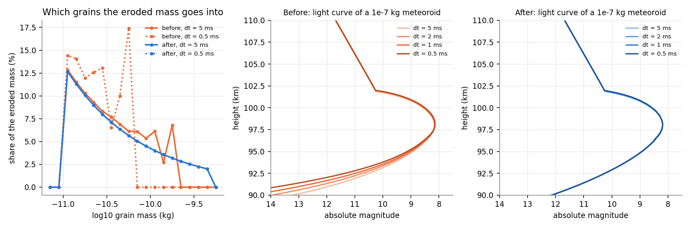
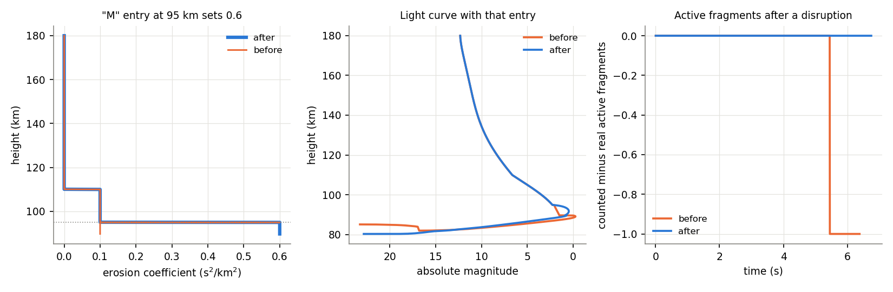
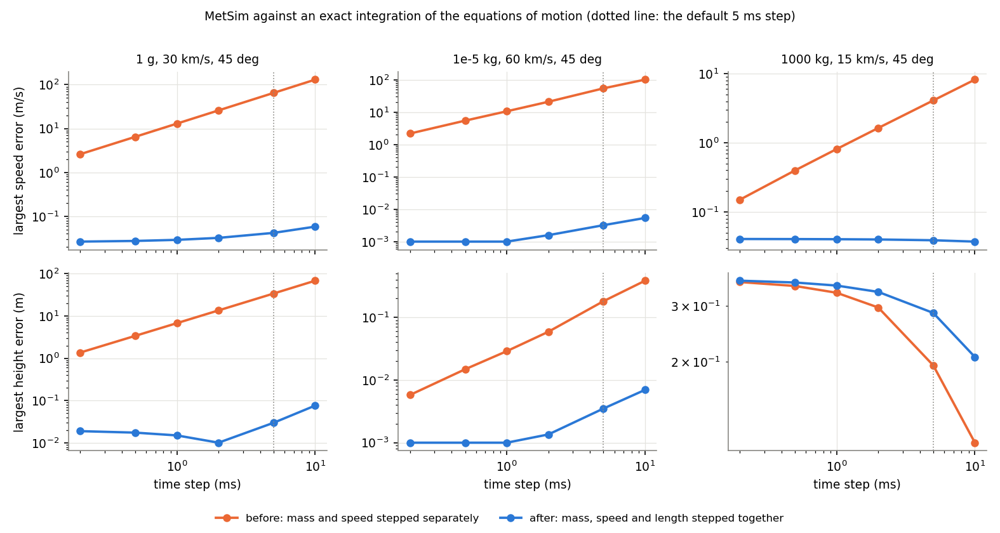
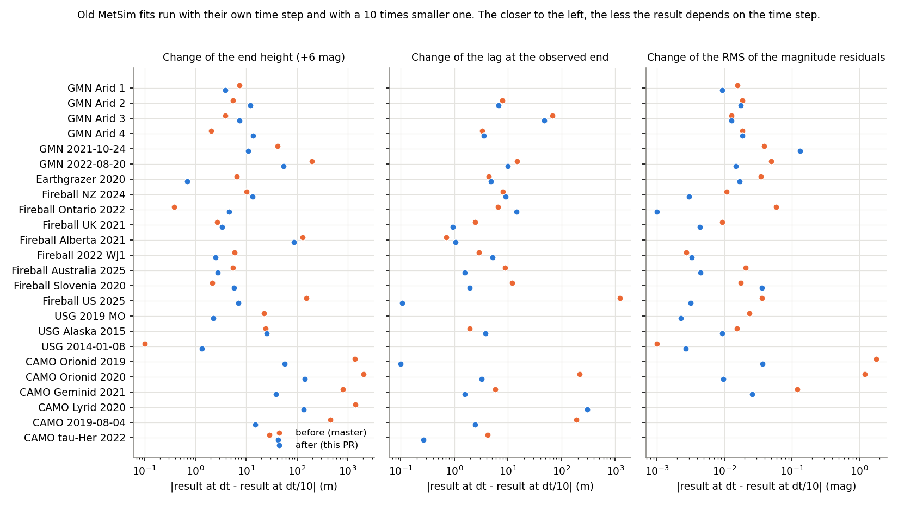
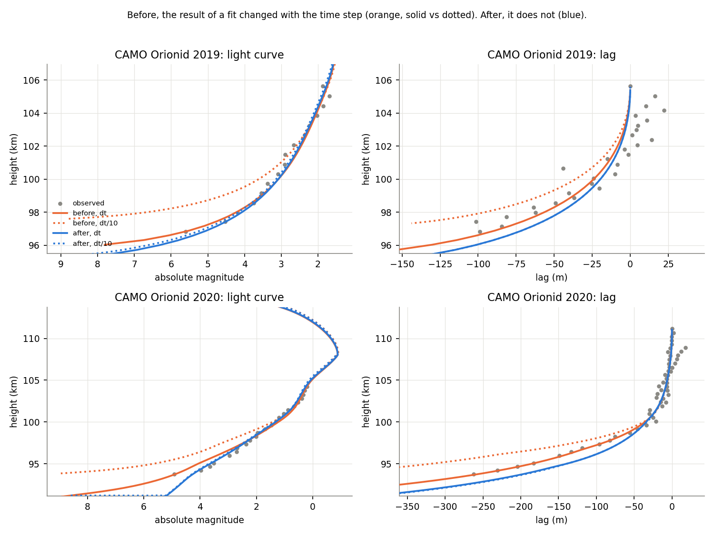

# The MetSim ablation model: what it computes and how far to trust it

**`wmpl.MetSim.MetSimErosion`** simulates a meteoroid entering the atmosphere: it slows down, loses mass,
erodes into small grains, can break into fragments, and gives off light. It follows the erosion model of
Borovička et al. (2007) as used in Vida et al. (2023). The MetSim GUI (`wmpl.MetSim.GUI`) and the
nested-sampling fits (`wmpl.Dynesty`) both run it.

This page explains, in plain terms, what the simulation computes at every step, how the grains and the
fragmentation entries work, and how the simulation was checked against an exact solution of the equations
of motion. Read it if you want to know how far to trust a simulated light curve or lag, how to choose the
time step, or before you change the simulation.

## Table of Contents

- [The idea in one paragraph](#the-idea-in-one-paragraph)
- [The equations](#the-equations)
- [Gravity](#gravity)
- [Stepping through time](#stepping-through-time)
- [Erosion into grains](#erosion-into-grains)
- [Fragmentation entries](#fragmentation-entries)
- [Checks against an exact solution](#checks-against-an-exact-solution)
- [Old fits run again](#old-fits-run-again)
- [Choosing the time step](#choosing-the-time-step)
- [Limits of the model](#limits-of-the-model)

---

## The idea in one paragraph

The simulation follows a list of fragments. At the start there is one, the meteoroid. Every time step
(5 ms by default) each fragment moves along the path, slows down because the air drags it, and loses mass
because the air heats and vaporises its surface (ablation). A fragment which erodes also sheds small grains,
which become fragments of their own. The light is added up over all fragments, and the height and the
length of the leading fragment give the trajectory that is compared to the observations.

## The equations

Every fragment has a mass `m`, a speed `v` and a length `l` travelled along the path. A fragment that
stands for a group of identical grains also has a count `n`, and gives `n` times the light of one grain.
They change as

```
dm/dt = -K*sigma*m^(2/3)*rho_atm*v^3          (mass loss)
dv/dt = -K*m^(-1/3)*rho_atm*v^2 + g*cos(z)     (drag, and gravity along the path)
dl/dt = v
```

- `K = Gamma*A*rho_m^(-2/3)` is the shape-density coefficient: the drag coefficient `Gamma`, the shape
  factor `A` and the bulk density `rho_m`. A larger `K` means more drag and more mass loss for a given mass.
- `sigma` is the ablation coefficient, plus the erosion coefficient `eta` while the fragment erodes.
- `rho_atm` is the air density at the height of the fragment.
- `z` is the local zenith angle of the path, and `g` the gravity at the height of the fragment.

The light `I` and the ionization `q` come from the mass loss and from the slowing down by the air:

```
I = -tau*(v^2/2*dm/dt + m*v*dv_air/dt)
q = -beta/(mu*v)*dm/dt
```

where `tau` is the luminous efficiency and `beta` the ionization coefficient.

The height comes from the length: the path is a straight line in space from the beginning height at the
beginning zenith angle, so the height follows the curvature of the Earth, and gravity pulls the fragment
below the line (next section).

## Gravity

Gravity does two things to a fragment:

- **Along the path,** `g*cos(z)` speeds the fragment up. For a fireball at 45 deg this is about 7 m/s for
  every second of flight. It is in the speed equation above, so it is also in the length.
- **Across the path,** `g*sin(z)` pulls the fragment below the straight line. The fragment gets a small
  speed across the path, which grows with `g*sin(z)`, and the air slows it down in the same way as it slows
  the fragment. The height of the fragment is the height of the straight line minus the vertical part of
  this drop.

Without drag, the drop is the free fall `g*t^2/2`. With drag it is smaller: a fireball that slows from
13 to 2.5 km/s drops by 86 m in 9 s, not 390 m.

## Stepping through time

The equations cannot be solved on paper, so the simulation takes them in steps of `dt`. In each step, the
mass, the speed and the length of a fragment are advanced **together** with the 4th order Runge-Kutta
method (`ablationStepRK4()` in `MetSimErosionCyTools.pyx`):

1. Take the rates of change at the start of the step.
2. Use them to estimate the state half a step later, and take the rates there. Do it twice.
3. Estimate the state at the end of the step, and take the rates there.
4. Advance by a weighted average of the four rates.

At each of the four stages, the air density is taken at the height where the fragment would be at that
stage. This matters: a fast meteor descends by 50-150 m in one step, and the air density changes by 1-2 %
over that distance, so the density at the start of the step is not good enough.

A small grain deep in the atmosphere can lose most of its mass or speed within a fraction of a step. A step
which would change the mass or the speed by more than 30 % is split into two halves, and again if needed,
until every piece resolves the motion, and the pieces get longer again once it does. Larger fragments are
never split, as they change by much less than that in a step.

## Erosion into grains

A fragment that erodes loses mass to grains at the rate `-K*eta*m^(2/3)*rho_atm*v^3`, where `eta` is the
erosion coefficient. The grains have masses between `erosion_mass_min` and `erosion_mass_max`, with a
power-law (or gamma) distribution of masses set by the mass index. The range of masses is split into bins,
`erosion_bins_per_10mass` per factor of 10 in mass, and every bin releases grains of one mass.

In one time step a fragment often erodes less mass than one grain of a bin, especially the bins of the
largest grains. So every bin keeps count of the fraction of a grain it has gathered over the steps, and
releases a grain when it has gathered a whole one. When the fragment ends, whatever fractions are left in
the bins are released as fragments that stand for a fraction of a grain. This way:

- all of the eroded mass ends up in grains, and
- the grains have the same masses whatever the time step.

A fragment which ends because it is too slow (`v_kill`), too low (`h_kill`) or too far (`len_kill`) does not
release them, as grains with its speed and height would end in their first step.

The figure shows it for a 1e-7 kg meteoroid. On the left, the share of the eroded mass that goes into
grains of each mass, at a 5 ms and a 0.5 ms step. If every step rounds the number of grains in a bin down
and passes the rest to the next smaller bin (orange), the smaller the step, the more mass ends up in the
smallest grains, and up to 5 % of the mass is lost. With the bins keeping their fractions (blue), the
distribution is the same at any step, and so is the light curve (middle and right).



## Fragmentation entries

The fragmentation file of the GUI lists events at given heights:

| Type | What it does |
|---|---|
| `M` | Changes the main fragment: ablation coefficient, erosion coefficient, grain masses, mass index. The erosion coefficient of the entry is kept from its height down; the height-dependent erosion coefficient (`erosion_height_change`) no longer applies to the main fragment after that. |
| `A` | Changes the ablation coefficient and Gamma of all fragments. |
| `F` | Splits off single-body fragments with a percentage of the mass of the main fragment, at most 100 %. |
| `EF` | Splits off eroding fragments. The mass index is 2.0 if none is given. |
| `D` | Releases dust grains with a percentage of the mass. The mass index is 2.0 if none is given. |

The figure shows an `M` entry at 95 km that sets the erosion coefficient to 0.6 s^2/km^2. The new
coefficient must stay below 95 km (left, blue), and it changes the light curve (middle). On the right, the
count of active fragments, which ends the simulation when it reaches zero, must match the fragments that
are really active, also after a disruption.



## Checks against an exact solution

The tests in `wmpl/MetSim/Tests/test_MetSimGravityDrop.py` and `test_MetSimIntegration.py` solve the motion
of a single body in a completely different way: in the plane of its path, in a frame fixed to the centre of
the Earth, with the full central gravity, the same drag and mass loss as MetSim, and an adaptive
high-accuracy integrator (`scipy.integrate.solve_ivp`, DOP853, relative tolerance 1e-11). This is as close
to the exact answer as we can get. MetSim is compared to it in height and speed at the same time.



Three bodies are shown: a 1 g meteor at 30 km/s, a 0.01 g meteor at 60 km/s and a 1000 kg fireball at
15 km/s. If the mass and the speed are stepped separately with the air density held at the start of the
step (orange), the errors shrink only in proportion to the step, and at the default 5 ms step the 1 g
meteor is off by up to 65 m/s in speed and 34 m in height. Stepped together with the density at every
stage (blue), the errors are a few cm and cm/s at the default step. For the 1000 kg fireball, the 0.3 m
that is left in height does not change with the step: it is the difference between "a straight line plus a
drop" and the full motion under central gravity over 100 km of path, and is far below what can be measured.

## Old fits run again

24 saved MetSim fits of real events (GMN meteors, CAMO meteors, fireballs, USG events and an earthgrazer)
were run with their own time step and with a 10 times smaller one. A fit is only meaningful if it does not
depend on the time step, as the time step is a numerical choice, not physics.



With the mass and the speed stepped separately and the grains rounded down in every step (orange), the
eroding CAMO meteors changed a lot with the time step: the end height by up to 2.1 km, and the RMS of the
light-curve residuals of two Orionids went from 0.15 and 0.26 mag to 1.9 and 1.5 mag. The lag at the end of
a US fireball of 2025 moved by 1.2 km. These fits had been tuned, without anyone knowing, to the numerical
error of the time step. With the coupled steps and the grain bins (blue), the largest changes are 0.14 km
in the end height and 0.13 mag in the RMS of the residuals, 15 times smaller. What is left comes from things
which happen at the end of a step: the start of the erosion, a fragmentation entry, or the end of a
fragment. The largest change left in the lag, 0.3 km for the CAMO Lyrid, is of that kind: once the main
fragment is gone, the leading fragment is the leading grain, and the step in which it ends sets where the
lag stops (at 75 % of the path the two steps agree to 0.3 m).

The substeps also matter for short flares from fragmentation entries. Dust released deep in the atmosphere
burns up within a fraction of a step, and a step which does not resolve it loses 13-15 % of the light of the
flares of the 2022 WJ1 and the Ontario 2022 fireballs at their time step. With the substeps, the light in the
flares is the same as with a 10 times smaller step, and their peaks are 0.3-0.4 mag brighter than with the
steps taken separately. The peak magnitude of a flare shorter than a step still depends on the
step, as the light of a step is its average over the step, but the light in the flare does not.



The two CAMO Orionids show the light curve and the lag moving with the time step before (orange solid vs
dotted), but not after (blue solid vs dotted). The figure also shows that a fit made with the old code is
not exactly a fit with the new code (orange solid vs blue solid), so old fits of eroding meteors need to be
adjusted to be used with it.

## Choosing the time step

With the coupled steps, the default `dt = 0.005 s` follows the motion of a fragment to a few cm and cm/s
for meteors and fireballs, and the grains do not depend on it, so a smaller step does not change a fit.
Use a larger step only for long, slow events such as earthgrazers, and check the result once with a step
10 times smaller.

The erosion starts at the end of the step in which the fragment passes `erosion_height_start`, so the start
can be late by up to `v*dt`, which is under a kilometre.

## Limits of the model

- The height comes from a straight line in space plus the gravity drop. For a long grazing path lasting
  minutes, this is not a substitute for integrating the full motion in three dimensions.
- The simulation runs in the frame of the ground, with the speed and zenith angle relative to the air
  (`constantsRelativeToGround()`), but the path is a straight line in that rotating frame, so the
  vertical Coriolis acceleration, `2*Omega*cos(latitude)*v_east`, is left out. It is up to about 5 % of
  `g`.
- The drag and the mass loss of a fragment do not depend on the other fragments, and the grains do not
  shield each other.
- The light and the ionization of a step use the mass loss and the deceleration averaged over the step,
  with the mass, the speed and the luminous efficiency in the middle of the step.
