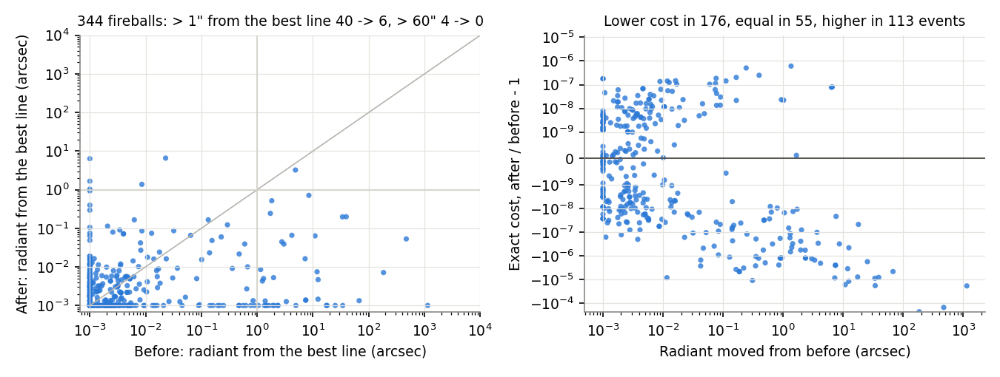

# Solving a trajectory

**The trajectory solver** turns multi-station meteor observations into a trajectory and a heliocentric
orbit, and saves the result as a pickle file. That pickle is the input to most of the rest of the
library, including [the REBOUND integrator](REBOUND.md), so this page is mainly about how to produce
one and what is inside it.

## Table of Contents

- [Running the solver](#running-the-solver)
- [The trajectory pickle](#the-trajectory-pickle)
- [Time scale](#time-scale)
- [Loading a pickle in Python](#loading-a-pickle-in-python)
- [How the line is fitted to the lines of sight](#how-the-line-is-fitted-to-the-lines-of-sight)
- [How the solver takes gravity into account](#how-the-solver-takes-gravity-into-account)

---

## Running the solver

The solver is driven through the input format of your data, not through a single generic entry point.
Each format module under `wmpl/Formats/` has its own command line interface that reads the
observations, runs the solver and writes the results:

```
python -m wmpl.Formats.ECSV /path/to/event/*.ecsv
python -m wmpl.Formats.RMSJSON /path/to/event/*.json
python -m wmpl.Formats.CAMS /path/to/event/
python -m wmpl.Formats.Met /path/to/event.met
```

Run any of them with `--help` for the full list of options. The ones that matter most often:

| Flag | Description |
| :--- | :--- |
| `-s`, `--solver` | Which solver to use. `original` (default) is the Monte Carlo solver; `gural0`–`gural3` are the Gural multi-parameter fits with constant, linear, quadratic and exponential deceleration. |
| `-r`, `--mcruns` | Number of Monte Carlo runs used to estimate the uncertainties. |
| `-d`, `--disablemc` | Only compute the geometric solution, skipping the Monte Carlo step. Fast, but gives no uncertainties. |
| `-t`, `--maxtoffset` | Maximum timing offset allowed between stations, in seconds, 5 s by default. With 3 or more stations, a station whose clock needs a larger offset is ignored. |
| `-v`, `--vinitht` | Estimate the initial velocity as the average above this height, in km. |
| `--disableairrot` | Keep the air at rest when computing the drop across the path (see [The drop](#the-drop)). |
| `-l`, `--plotallspatial` | Save the full set of diagnostic plots. |

To see the solver working on a synthetic example without any data of your own:

```
python -m wmpl.Trajectory.Trajectory
```

## The trajectory pickle

A successful run writes `<event>_trajectory.pickle` (plus plots and a text report) into the output
directory. The pickled object is a `wmpl.Trajectory.Trajectory.Trajectory`. The attributes used by the
other tools are:

| Attribute | Meaning |
| :--- | :--- |
| `traj.jdt_ref` | Reference epoch of the trajectory, as a Julian date in TDB. |
| `traj.traj_id` | Identifier of the event, e.g. `20191023_091225`. Used as the object name downstream. |
| `traj.orbit` | The computed heliocentric orbit, including the geocentric radiant and velocity. |
| `traj.state_vect_mini`, `traj.v_init`, `traj.radiant_eci_mini` | Position, speed and radiant direction at the reference point. Together these are the state vector REBOUND starts from. |
| `traj.uncertainties` | One-sigma uncertainties from the Monte Carlo runs, used to draw clones. |
| `traj.observations` | The per-station observations that went into the fit. |
| `traj.gravity_t0`, `traj.gravity_vel` | Time from which the gravity drop is computed, and the speeds of the meteor against time with which it is computed (see below). Pickles from before they were added have neither. |

## Time scale

The solver takes the times of the measurements as UTC and computes the rotation of the Earth (the sidereal
time) from them, without the difference UT1 - UTC, which stays below 0.9 s. RMS and CAMS reduce their
observations the same way. The R.A./Dec. of star-calibrated measurements are right in the inertial frame, so
for them the Earth-fixed frame of the solution is turned by the rotation of the Earth during UT1 - UTC, up to
13.5 arcsec. On the straight synthetic meteor of the tests (3 stations, 2.5 s at 30 km/s), with UT1 - UTC of
0.5 s and 0.9 s the trajectory is 3.7 m and 6.6 m off the true line in the Earth-fixed frame and the radiant
2.7 and 4.9 arcsec off in it, while the inertial radiant moves by 0.16 and 0.28 arcsec.

## Loading a pickle in Python

```python
import os
from wmpl.Utils.Pickling import loadPickle

pickle_path = "/path/to/20191023_091225_trajectory.pickle"
traj = loadPickle(*os.path.split(pickle_path))

print(traj.traj_id, traj.jdt_ref)
print("a = {:.4f} AU, e = {:.4f}".format(traj.orbit.a, traj.orbit.e))
```

Once you have the pickle, see [the REBOUND manual](REBOUND.md) for integrating the orbit backwards or
forwards in time.


## How the line is fitted to the lines of sight

The solver starts from the line where the planes of the lines of sight of two stations intersect, and then
fits the line to the lines of sight of all stations at once: it looks for the line with the smallest sum of
the angles between it and every line of sight, with each station weighted by how well it sees the line
(Borovicka 1990, with angles instead of distances, `angleSumMeasurements2Line()` in `Trajectory.py`). The
sum is minimized with the Nelder-Mead simplex method over the four ways a line can move, two turns and two
shifts, restarted with a fresh simplex until the line stops moving (`nelderMeadLine()`).

The angles are not squared, so the sum has a sharp bend, like `|x|`, wherever the line passes through a line
of sight. The simplex can stop at such a bend although the line could still get better. When 344 fireballs
of the GMN and UWO databases were solved again, 40 of them (12 %) ended more than 1 arcsec from the best
line, 4 more than 1 arcmin and one 19 arcmin away. The solver therefore first minimizes a smoothed sum, in
which every angle is replaced by `sqrt(angle^2 + s^2) - s`, which is round near zero and the same as the
angle minus `s` far from it. It takes `s` = 10, 1, 0.1 and 0.01 arcsec in turn (`LOS_SMOOTHING`), each time
from the line found with the one before, and then minimizes the exact sum. The result is never worse in the
exact sum than the line it started from.

With the smoothing, 6 of the 344 fireballs (2 %) end more than 1 arcsec from the best line, and none more
than 7 arcsec. Where the fit did not stop early, the radiant moves by 0.004 arcsec (median). The residuals do
not change, and solving takes 26 % less time, although the smoothed sums take about three times as many
evaluations, as the angles of all points are computed at once.




## How the solver takes gravity into account

A meteor does not fly in a straight line: gravity bends its path down. The solver fits a straight line to
the lines of sight of all stations, so it fits the line the meteor would have followed without gravity,
the line along its direction of flight at the beginning, and moves every point of the model down from that
line by how far gravity has pulled the meteor at that time (the gravity drop). The line, and so the
radiant, is only right if the drop is right.

### The drop

Gravity pulls the meteor towards the centre of the Earth. Only the part of the pull across the path moves
the meteor off the line. The part along the path speeds it up, which is already in the lengths measured
along the line.

The pull across the path gives the meteor a small speed across the path, which grows by `g_across` every
second, and the air slows that speed in the same way as it slows the meteor: if the meteor loses 20 % of its
speed in a second, it also loses 20 % of its speed across the path. So the speed across the path `w`
follows

```
dw/dt = g_across - (a_drag/v)*w
```

where `v` is the speed of the meteor and `a_drag` its deceleration by the air (the change of its speed
without gravity along the path). The drop is the integral of `w` over time. Gravity is taken from the
centre of the Earth at every point along the line, so it also turns with the curvature of the Earth along
long, shallow paths (`gravityDropTable()` in `Trajectory.py`).

The air rotates with the Earth, eastwards at up to 465 m/s at the equator, so the drag acts against the
velocity of the meteor relative to the air, not against its velocity in ECI. The drag pulls the speed
across the path towards the speed of the air across the path, so the equation is

```
dw/dt = g_across + a_drag/(v - u_along)*(u_across - w)
```

where `u = omega x r` is the velocity of the air at the points of the line. This moves a decelerating
fireball across its line even without gravity. On a fireball which slows from 13 to 3.3 km/s at 45 deg N,
integrated with the rotating air, the radiant is within 2.1 arcsec and the positions within 0.8 m, against
525 arcsec and 284 m with the air at rest in the solver. The rotating air is used by default.
`Trajectory(air_rotation=False)`, or `--disableairrot` on the command line, keeps the air at rest in ECI.

340 fireballs of the GMN and UWO databases were solved without the Monte Carlo, with and without the
rotating air. The radiants moved by 161 arcsec (median) and by 916 arcsec at the 90th percentile,
depending on how much the fireball slows:

| Speed lost (1 - v_avg/v_init) | Events | Radiant moved (median) | Change of the angular residuals (median) |
| :--- | ---: | ---: | ---: |
| below 5 % | 100 | 17 arcsec | 0 % |
| 5 - 15 % | 120 | 247 arcsec | -1.6 % |
| 15 - 30 % | 79 | 374 arcsec | -2.9 % |
| above 30 % | 11 | 1747 arcsec | -30 % |

The residuals of all 11 fireballs which lost more than 30 % of their speed went down. In some events the
residuals of single stations at the slow end went up, mostly of uncalibrated casual videos whose picks
could have been adjusted to the old solution. Solving takes 12 % more CPU time, as the minimisation
needs more steps.

Before, every point was dropped by the free fall `g*t^2/2` along its own vertical. That is right for a
short, fast meteor, but a decelerating fireball drops much less than a free fall, and the vertical is not
the direction across the path. The figure shows the drop of two fireballs below the line of their beginning,
integrated exactly with gravity and drag (dotted), with the free fall (orange) and with the drop across the
path slowed by the drag (blue). The fireball which slows from 13 to 3.3 km/s drops by 74 m, not by 102 m.


### The speeds

The drop needs the speed of the meteor at every time. The solver takes it from the pass before the gravity
pass, by fitting the drag equation

```
dv/dt = -K*rho*v^2 + g_along
```

to the lengths and times of the used points of all stations, with the air density of the NRLMSIS model
along the line and a ballistic coefficient `K` which can only grow, as in [DragFit](DragFit.md), but only
over the observed part (`wmpl.Utils.DragVelocity`). This takes about 30 ms. If there are fewer than 12
points or the fit fails, the Jacchia (1955) model of the length is fitted instead. The speeds are kept in the
trajectory as `traj.gravity_vel`.

Gravity along the path speeds the meteor up, and the lengths keep the length it gained from it,
`g_along*t^2/2`, as they are the real distances along the path (DragFit and MetSim model it). It is taken off
before the initial velocity is fitted to the lengths, so the initial velocity is the speed at the beginning,
and off the lag, so the lag is the deceleration by the air only.

The drop starts at the first time of the used stations (`traj.gravity_t0`), so a station which the solver
does not use does not change the solution.

### Checks

The tests in `wmpl/Trajectory/Tests/test_GravityDropAcrossPath.py` integrate fireballs exactly, with the
central gravity of the Earth, the drag and the mass loss, observe them from three stations and solve them.
Without noise, the radiant was off by 4 to 26 arcsec with the free fall and the lengths by 25 to 215 m.
With the drop across the path slowed by the drag, the radiant is within 0.2 arcsec and the lengths within
3 m. With 30 arcsec of noise on the measurements, the median error of the radiant over 20 runs of the
decelerating fireball goes from 56 to 12 arcsec. For the fireball at 15 km/s it stays at 9-10 arcsec, which
is the noise.


344 fireballs of the GMN and UWO databases were solved again without the Monte Carlo. Their radiants moved
by 21 arcsec (median), more for longer events: about 1 arcsec for events shorter than 2 s, 12 arcsec for
2-5 s, 25 arcsec for 5-10 s and 29 arcsec for longer ones (3 or more stations). The residuals did not change
(median ratio 1.000), and solving takes 9 % longer. The largest moves are events seen from 2 stations, whose
line is weakly constrained, and events where the minimisation stopped early before.


### Older solutions

Pickles solved before the speeds were added have no `traj.gravity_vel`. DragFit and DynamicMassFit drop
their points vertically, as the solver did when it solved them, so they stay consistent with their line.
Solve them again to use the new drop.

Pickles solved before the rotating air was added are solved again with it, so their radiants move as in the
table above. Use `--disableairrot` to solve them again with the air at rest.

### Limits

- The drop is computed from the line of the current solution, so it assumes that the drop is small next to
  the path, as it is (hundreds of metres against tens to hundreds of kilometres).
- The Earth's gravity is that of a point mass. The flattening of the Earth changes it by about 0.1 %.
- The speeds come from one drag fit to all stations. If the timing of a station is wrong, so are the speeds
  at its times, but the drop changes slowly with the speed.
