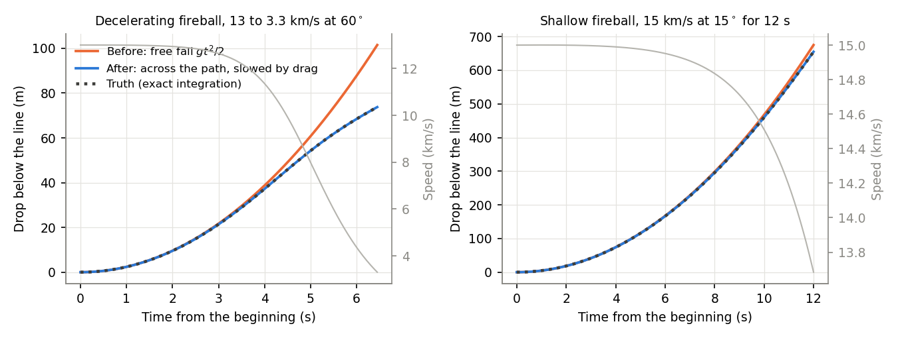
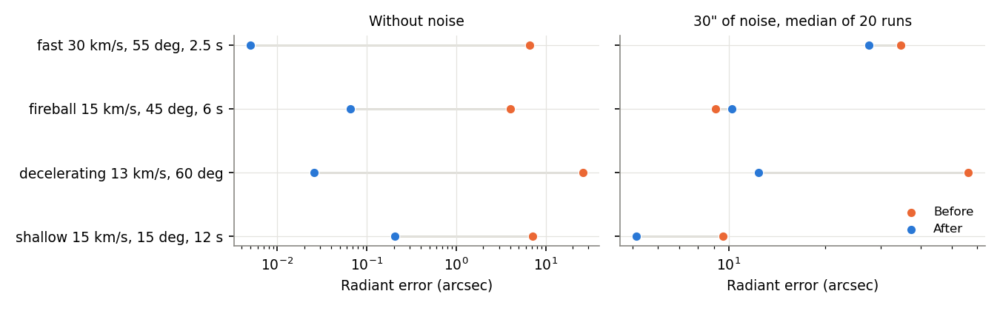
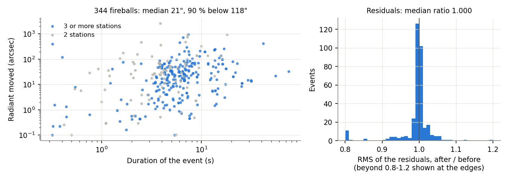

# Solving a trajectory

**The trajectory solver** turns multi-station meteor observations into a trajectory and a heliocentric
orbit, and saves the result as a pickle file. That pickle is the input to most of the rest of the
library, including [the REBOUND integrator](REBOUND.md), so this page is mainly about how to produce
one and what is inside it.

## Table of Contents

- [Running the solver](#running-the-solver)
- [The trajectory pickle](#the-trajectory-pickle)
- [Loading a pickle in Python](#loading-a-pickle-in-python)
- [How the solver takes gravity into account](#how-the-solver-takes-gravity-into-account)

---

## Running the solver

The solver is driven through the input format of your data, not through a single generic entry point.
Each format module under `wmpl/Formats/` has its own command line interface that reads the
observations, runs the solver and writes the results:

```
python -m wmpl.Formats.ECSV /path/to/event/*.ecsv
python -m wmpl.Formats.RMSJSON /path/to/event/*.json
python -m wmpl.Formats.CAMS /path/to/event/
python -m wmpl.Formats.Met /path/to/event.met
```

Run any of them with `--help` for the full list of options. The ones that matter most often:

| Flag | Description |
| :--- | :--- |
| `-s`, `--solver` | Which solver to use. `original` (default) is the Monte Carlo solver; `gural0`–`gural3` are the Gural multi-parameter fits with constant, linear, quadratic and exponential deceleration. |
| `-r`, `--mcruns` | Number of Monte Carlo runs used to estimate the uncertainties. |
| `-d`, `--disablemc` | Only compute the geometric solution, skipping the Monte Carlo step. Fast, but gives no uncertainties. |
| `-t`, `--maxtoffset` | Maximum timing offset allowed between stations, in seconds. |
| `-v`, `--vinitht` | Estimate the initial velocity as the average above this height, in km. |
| `-l`, `--plotallspatial` | Save the full set of diagnostic plots. |

To see the solver working on a synthetic example without any data of your own:

```
python -m wmpl.Trajectory.Trajectory
```

### Additional fragments in ECSV files

ECSV files can describe more fragments than the main one, as in Appendix 4 of the GFE standard: one row
per frame, with the columns of each additional fragment carrying its number as a suffix (`datetime1`,
`ra1`, `dec1`, `azimuth1`, `altitude1`, ...), empty on the frames where it was not measured. The main
fragment, fragment 0, is always solved from the columns without a suffix (or with the optional suffix 0),
leaving out its points with `trajectory_use` = False (e.g. saturated flares kept in the file).

```
python -m wmpl.Formats.ECSV /path/to/event/*.ecsv --fragments
```

| Flag | Description |
| :--- | :--- |
| `--fragments` | After the main fragment, solve every additional fragment seen from at least 2 stations with the same options (Monte Carlo included), save each one in a `fragment_k` folder of the output directory, and print how it differs from the main one: convergence angle of its stations, radiant, velocities, heights, distance from the main path and how far ahead of the main fragment it is at the same time. |
| `--fragtimefit` | Estimate the station time offsets for every fragment, instead of reusing those of the main trajectory, which its larger number of points constrains better. Without the timing estimation (`-e`), the fragments take the same fixed offsets as the main fragment. |
| `--fragnosys` | Leave out of the Monte Carlo uncertainties of the fragments the systematic errors of the stations, which are otherwise included when the main trajectory has 3 stations or more (see below). |

Two solutions differ slightly even for identical data, as each goes through its own iterations of the
timing and velocity estimation: in tests, by about 0.001 deg and tens of metres with well spread stations,
and up to about 0.1 deg and a few hundred metres with nearly parallel ones. With the Monte Carlo runs, the
solutions compared are still those with the original picks (not the best Monte Carlo runs, which differ by
about 1 sigma even for identical data), and the differences are also given in units of the combined
uncertainty. The time offsets reused by the fragments are also those of the main solution with the original
picks, the ones in its report.

The comparison notes a fragment more than 1.5 km off the main path at its first or last point. No fragment
of the main went further in fireballs simulated with MetSim (2 to 7 fragments, with the lateral speeds of
real fragmentations, stations converging by 20 deg), while fragments of another body 2 km away did in 97 %
of the cases. Such a fragment may come from another body, the stations may have measured different fragments
under the same number, or its trajectory may be poorly constrained: with stations converging by 8 deg, 8 to
14 % of the fragments of the main went further. Two stations measuring different fragments mostly give a line
close to the main path anyway, and often no trajectory at all.

With the Monte Carlo runs, the distance off the main path is also given in units of the uncertainty of both
paths there, from the scatter of their runs across it (the Mahalanobis distance), and a fragment more than
1.5 km off but within 3 sigma is noted as poorly constrained instead. On 24 fireballs simulated with MetSim
per case, solved after merging master, this kept 99 % of the fragments of another body 2 km away noted, and
cut the fragments of the main noted from 6 to 2 % with stations converging by 20 deg, and from 27 to 8 % by
8 deg. A fragment of the main is often more than 3 sigma off, as it truly separates from it by up to 600 m,
and the runs are slightly optimistic: 80 % of the errors were within their 95 % region.

With the time offsets of the main trajectory, the comparison also gives how far apart along the path of the
fragment every two of its stations see it at the same times, from their points on its line, as a constant
difference in a joint fit of their positions in time, and notes more than 1 km. Two stations measuring
different fragments see them where the line passes closest to their lines of sight, at different places
along it. In the simulated fireballs, 0.2 to 0.3 % of the fragments of the main went further, against 70 %
of the fragments whose 2 stations measured different fragments, and 56 % with 3 stations, one of which did.
Time offsets estimated for the fragment (`--fragtimefit`) would absorb the difference, so it is then not
given.

The comparison also gives the convergence angle of the stations of every fragment, against that of the main
trajectory, and notes one below 3 deg, the least the trajectory correlator of WMPL takes. Two stations that
hardly converge for a fragment, e.g. close to each other and looking the same way, still give a line, but one
which the small errors of their picks can turn far from the true path.

The pointing of a station can be off by the same amount at all its points (its calibration, or the centroid
of a saturated meteor), which does not average out with their number, so the Monte Carlo runs do not
include it. With 3 or more stations in the main trajectory, the others constrain its line, and the residuals
of each station across the line show its own error, as a constant and a slope along the trajectory. Their
typical size is added to the Monte Carlo runs of every fragment, as a random constant and slope of each
station in every run. The solution of the fragment is the one with the original picks, as without them, and
only its uncertainties change. On fireballs simulated with MetSim, with 2 to 7 fragments, noise and
saturation, the true direction of a fragment was within the 95 % region of its uncertainties in 93 % of the
cases with them, and in 75 % without. With 2 stations in the main trajectory there is nothing to measure,
and the solver says so.

## The trajectory pickle

A successful run writes `<event>_trajectory.pickle` (plus plots and a text report) into the output
directory. The pickled object is a `wmpl.Trajectory.Trajectory.Trajectory`. The attributes used by the
other tools are:

| Attribute | Meaning |
| :--- | :--- |
| `traj.jdt_ref` | Reference epoch of the trajectory, as a Julian date in TDB. |
| `traj.traj_id` | Identifier of the event, e.g. `20191023_091225`. Used as the object name downstream. |
| `traj.orbit` | The computed heliocentric orbit, including the geocentric radiant and velocity. |
| `traj.state_vect_mini`, `traj.v_init`, `traj.radiant_eci_mini` | Position, speed and radiant direction at the reference point. Together these are the state vector REBOUND starts from. |
| `traj.uncertainties` | One-sigma uncertainties from the Monte Carlo runs, used to draw clones. |
| `traj.observations` | The per-station observations that went into the fit. |
| `traj.gravity_t0`, `traj.gravity_vel` | Time from which the gravity drop is computed, and the speeds of the meteor against time with which it is computed (see below). Pickles from before they were added have neither. |

## Loading a pickle in Python

```python
import os
from wmpl.Utils.Pickling import loadPickle

pickle_path = "/path/to/20191023_091225_trajectory.pickle"
traj = loadPickle(*os.path.split(pickle_path))

print(traj.traj_id, traj.jdt_ref)
print("a = {:.4f} AU, e = {:.4f}".format(traj.orbit.a, traj.orbit.e))
```

Once you have the pickle, see [the REBOUND manual](REBOUND.md) for integrating the orbit backwards or
forwards in time.


## How the solver takes gravity into account

A meteor does not fly in a straight line: gravity bends its path down. The solver fits a straight line to
the lines of sight of all stations, so it fits the line the meteor would have followed without gravity,
the line along its direction of flight at the beginning, and moves every point of the model down from that
line by how far gravity has pulled the meteor at that time (the gravity drop). The line, and so the
radiant, is only right if the drop is right.

### The drop

Gravity pulls the meteor towards the centre of the Earth. Only the part of the pull across the path moves
the meteor off the line. The part along the path speeds it up, which is already in the lengths measured
along the line.

The pull across the path gives the meteor a small speed across the path, which grows by `g_across` every
second, and the air slows that speed in the same way as it slows the meteor: if the meteor loses 20 % of its
speed in a second, it also loses 20 % of its speed across the path. So the speed across the path `w`
follows

```
dw/dt = g_across - (a_drag/v)*w
```

where `v` is the speed of the meteor and `a_drag` its deceleration by the air (the change of its speed
without gravity along the path). The drop is the integral of `w` over time. Gravity is taken from the
centre of the Earth at every point along the line, so it also turns with the curvature of the Earth along
long, shallow paths (`gravityDropTable()` in `Trajectory.py`).

Before, every point was dropped by the free fall `g*t^2/2` along its own vertical. That is right for a
short, fast meteor, but a decelerating fireball drops much less than a free fall, and the vertical is not
the direction across the path. The figure shows the drop of two fireballs below the line of their beginning,
integrated exactly with gravity and drag (dotted), with the free fall (orange) and with the drop across the
path slowed by the drag (blue). The fireball which slows from 13 to 3.3 km/s drops by 74 m, not by 102 m.



### The speeds

The drop needs the speed of the meteor at every time. The solver takes it from the pass before the gravity
pass, by fitting the drag equation

```
dv/dt = -K*rho*v^2 + g_along
```

to the lengths and times of the used points of all stations, with the air density of the NRLMSIS model
along the line and a ballistic coefficient `K` which can only grow, as in [DragFit](DragFit.md), but only
over the observed part (`wmpl.Utils.DragVelocity`). This takes about 30 ms. If there are fewer than 12
points or the fit fails, the Jacchia (1955) model of the length is fitted instead. The speeds are kept in the
trajectory as `traj.gravity_vel`.

Gravity along the path speeds the meteor up, and the lengths keep the length it gained from it,
`g_along*t^2/2`, as they are the real distances along the path (DragFit and MetSim model it). It is taken off
before the initial velocity is fitted to the lengths, so the initial velocity is the speed at the beginning,
and off the lag, so the lag is the deceleration by the air only.

The drop starts at the first time of the used stations (`traj.gravity_t0`), so a station which the solver
does not use does not change the solution.

### Checks

The tests in `wmpl/Trajectory/Tests/test_GravityDropAcrossPath.py` integrate fireballs exactly, with the
central gravity of the Earth, the drag and the mass loss, observe them from three stations and solve them.
Without noise, the radiant was off by 4 to 26 arcsec with the free fall and the lengths by 25 to 215 m.
With the drop across the path slowed by the drag, the radiant is within 0.2 arcsec and the lengths within
3 m. With 30 arcsec of noise on the measurements, the median error of the radiant over 20 runs of the
decelerating fireball goes from 56 to 12 arcsec. For the fireball at 15 km/s it stays at 9-10 arcsec, which
is the noise.



344 fireballs of the GMN and UWO databases were solved again without the Monte Carlo. Their radiants moved
by 21 arcsec (median), more for longer events: about 1 arcsec for events shorter than 2 s, 12 arcsec for
2-5 s, 25 arcsec for 5-10 s and 29 arcsec for longer ones (3 or more stations). The residuals did not change
(median ratio 1.000), and solving takes 9 % longer. The largest moves are events seen from 2 stations, whose
line is weakly constrained, and events where the minimisation stopped early before.



### Older solutions

Pickles solved before the speeds were added have no `traj.gravity_vel`. DragFit and DynamicMassFit drop
their points vertically, as the solver did when it solved them, so they stay consistent with their line.
Solve them again to use the new drop.

### Limits

- The drop is computed from the line of the current solution, so it assumes that the drop is small next to
  the path, as it is (hundreds of metres against tens to hundreds of kilometres).
- The Earth's gravity is that of a point mass. The flattening of the Earth changes it by about 0.1 %.
- The speeds come from one drag fit to all stations. If the timing of a station is wrong, so are the speeds
  at its times, but the drop changes slowly with the speed.
